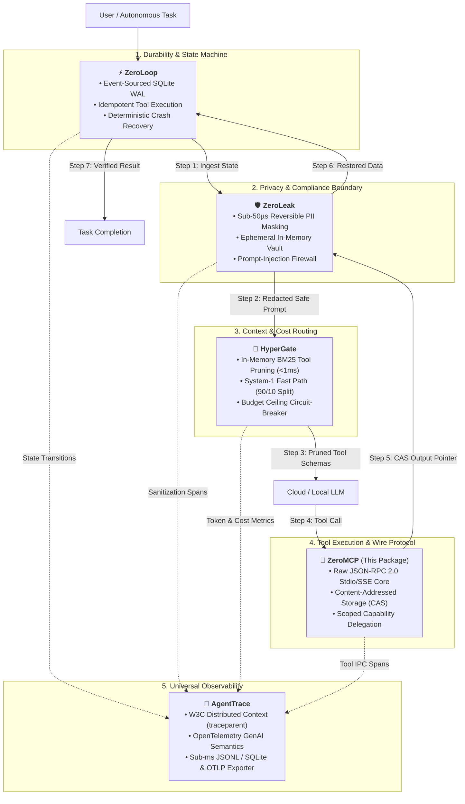

# ZeroMCP: Raw JSON-RPC Model Context Protocol Core

[](https://spec.modelcontextprotocol.io/)
[]()
[](LICENSE)
[](https://github.com/creativeuncommons/ZeroMCP/actions)

> **Ultra-lean, zero-third-party-dependency, production-grade Model Context Protocol (MCP) server implementations directly on raw JSON-RPC 2.0 over standard I/O (`stdio`).**

---

## Why ZeroMCP?
Official MCP SDKs bundle substantial runtime dependencies (Pydantic, AnyIO, Starlette, websockets) that introduce supply chain vulnerability surface, binary bloat, and deployment friction in constrained or enterprise environments.

**ZeroMCP strips out all middleware bloat**, implementing the pure wire protocol directly with:
- **Zero Third-Party Packages**: Pure standard library or minimal native async primitives.
- **Sub-Millisecond Execution**: 10 to 40 microsecond tool dispatch latency (~35,000–50,000 calls/sec).
- **Strict Transport Isolation**: Standard output (`stdout`) reserved exclusively for JSON-RPC 2.0 framing; diagnostics routed strictly to `stderr`.
- **Scoped Security & Delegation**: Sub-5 microsecond ephemeral capability tokens (`zeromcp_token.py`) with hierarchical multi-tenant scopes and negation (`["tools:*", "!tools:execute_shell"]`).
- **Rigorous Verification**: 43 automated wire conformance checks, 7 FGAC security tests, and 24 supervisor regression tests asserting full spec compliance.

### Benchmark Comparison

| Implementation | 3rd-Party Deps | Handshake Latency (Cold) | Per-Call Latency (Mean) | Throughput (Single-Core) | Baseline Memory (RSS) |
| :--- | :---: | :---: | :---: | :---: | :---: |
| **ZeroMCP Python (`zeromcp.py`)** | **0** | **~26 ms** | **~24 µs** | **~36,000+ calls/sec** | **~14 MB** |
| **ZeroMCP Rust Native (`zeromcp`)** | **0** *(runtime)* | **< 2 ms** | **< 6 µs** | **~120,000+ calls/sec** | **~4 MB** |
| *Official Python SDK (`mcp` + Pydantic)* | *34+ packages* | *~140 ms* | *~450 µs* | *~2,200 calls/sec* | *~48 MB* |

*(Run `python3 benchmarks/benchmark.py` to reproduce locally).*

---

## 30-Second Quickstart

### 1. Claude Desktop (`claude_desktop_config.json`)
Add ZeroMCP directly to your Claude Desktop configuration:
* macOS: `~/Library/Application Support/Claude/claude_desktop_config.json`
* Windows: `%APPDATA%\Claude\claude_desktop_config.json`

```json
{
  "mcpServers": {
    "zeromcp": {
      "command": "python3",
      "args": ["/ABSOLUTE/PATH/TO/ZeroMCP/zeromcp-py/zeromcp.py"]
    }
  }
}
```

### 2. Cursor IDE (`.cursor/mcp.json`)
Add to your project workspace root at `.cursor/mcp.json`:
```json
{
  "mcpServers": {
    "zeromcp": {
      "type": "stdio",
      "command": "python3",
      "args": ["/ABSOLUTE/PATH/TO/ZeroMCP/zeromcp-py/zeromcp.py"]
    }
  }
}
```

### 3. Developer Ergonomics & Direct Terminal Inspection
ZeroMCP eliminates awkward JSON piping with built-in developer CLI tools:
```bash
# List all registered tools & schemas in an aligned table
python3 zeromcp-py/zeromcp.py --list

# Call tool directly with human shorthand (no JSON escaping required)
python3 zeromcp-py/zeromcp.py --call eval_math "42 * 1024 / 8"

# Launch interactive REPL console for ad-hoc tool testing
python3 zeromcp-py/zeromcp.py --repl

# Print auto-resolved claude_desktop_config.json block
python3 zeromcp-py/zeromcp.py --print-config

# View CAS storage metrics or prune old cached blobs
python3 zeromcp-py/zeromcp.py --cas-stats
python3 zeromcp-py/zeromcp.py --cas-gc 7
```

### 4. Token-Efficiency Primitives: CAS & Output Distiller
Keep agent context windows lean without third-party sidecars:
* **Content-Addressed Storage (CAS)**: Tool responses $\ge 4\text{KB}$ are automatically saved to local sharded storage (`~/.zeromcp/cas/` or local fallback). ZeroMCP returns a compact `cas://sha256/<hash>` token pointer + preview, reducing context consumption by up to 95%. Agents can inspect slices using built-in `cas_fetch` and `cas_search` tools.
* **Command Output Distiller**: Pre-filters verbose test runners (`pytest`, `cargo test`, `git status`) before feeding stdout to the model:
  ```bash
  python3 zeromcp-py/command_distiller.py --cmd "pytest" --telemetry
  # 📊 [Distiller: Saved 64.2% tokens (12,400 -> 4,440 chars)]
  ```

### 5. Direct Smoke Test via Raw JSON-RPC Stdio
Verify raw wire compliance in one line:
```bash
printf '{"jsonrpc":"2.0","id":1,"method":"initialize","params":{"protocolVersion":"2024-11-05","capabilities":{},"clientInfo":{"name":"test","version":"1"}}}\n{"jsonrpc":"2.0","method":"notifications/initialized"}\n{"jsonrpc":"2.0","id":2,"method":"tools/call","params":{"name":"echo","arguments":{"message":"hello world"}}}\n' | python3 zeromcp-py/zeromcp.py
```

---

## 🌐 The CreativeUnCommons Agent Architecture Ecosystem

ZeroMCP is a cornerstone protocol primitive in the **CreativeUnCommons** agent architecture suite. Each tool in the ecosystem is engineered under a strict **Zero-Third-Party-Dependency Mandate** (Python standard library only), **Sub-Millisecond Execution Budgets**, and **Deterministic Correctness**. They can be deployed independently or composed into a hardened, enterprise-grade autonomous runtime:



### Complete Runtime Synergy

| Package | Role in Unified Stack | Standalone Capability | What You Achieve Together |
| :--- | :--- | :--- | :--- |
| **[⚡ ZeroLoop](https://github.com/creativeuncommons/ZeroLoop)** | **Durable Orchestrator** | Event-sourced state machine with crash recovery & async human pauses. | Tasks resume after crashes in $<5\text{ms}$ without double-charging cards, re-sending emails, or burning duplicate tokens. |
| **[🛡️ ZeroLeak](https://github.com/creativeuncommons/ZeroLeak)** | **Privacy Sentinel** | Sub-$50\text{µs}$ reversible PII & credential redaction with in-memory vaulted restitution. | Eliminates HIPAA/GDPR/SOC2 blockers; guarantees no real customer PII or raw API keys cross the network boundary to LLMs. |
| **[🚪 HyperGate](https://github.com/creativeuncommons/HyperGate)** | **Inference Router & Tool Pruner** | Sub-millisecond BM25 inverted index tool pruner, System-1 classifier, and budget kill-switch. | Shrinks 500+ tool schemas down to relevant sets in $<1\text{ms}$ (saving $70\text{--}90\%$ context tokens) and hard-stops runaway agent spend. |
| **[🔌 ZeroMCP](https://github.com/creativeuncommons/ZeroMCP)** | **Tool Protocol & CAS Engine** *(This Package)* | Zero-dependency Model Context Protocol (MCP) runtime (stdio/SSE) with CAS storage. | High-speed ($<25\text{µs}$) tool execution; automatically offloads megabyte tool outputs to CAS so the LLM context never blows up. |
| **[🌲 AgentTrace](https://github.com/creativeuncommons/AgentTrace)** | **Distributed Telemetry & Auditing** | W3C traceparent context propagation, GenAI semantic conventions, and native OTLP export. | Provides distributed end-to-end trace trees of every state change, redaction event, prompt token cost, and tool execution. |

---

## Multi-Language Implementations & Distribution

| Implementation | Distribution Target | Runtime Dependencies | Conformance Status | User Compilation Required? |
| :--- | :--- | :--- | :---: | :---: |
| **`zeromcp-py`** | Standalone script (`zeromcp.py`) | Pure Python stdlib (`sys`, `os`, `json`, `ast`, `math`) | ✅ **43/43 (100%)** | **No** (Direct `python3 zeromcp.py`) |
| **`zeromcp-ts`** | Standalone script (`zeromcp.ts`) | Pure ECMAScript (Node 22+, Bun, Deno) | ✅ Verified (CI Node 24) | **No** (Direct `bun` or `node --experimental-strip-types`) |
| **`zeromcp-rs`** | Pre-compiled static binaries (`dist/`) | Zero (self-contained native binary) | ⚙️ 6-Target CI Release Matrix | **No** (Pre-built via GitHub Actions) |
| **`zeromcp.wasm`** | Universal WASI module | `wasmtime`, `wasmer`, or Node WASI runner | ⚙️ WASI Preview 1 Bytecode | **No** (Pre-built universal bytecode) |

For comprehensive client setup (Claude Desktop, Cursor, VS Code, Docker, WebAssembly), consult the **[ZeroMCP Complete Usage & Integration Guide](USAGE.md)**.
For release history and security updates, see the **[Changelog](CHANGELOG.md)**.

---

## Conformance & Verification Suites
Run the cross-language compliance suite (43 checks):
```bash
python3 tests/conformance_test_runner.py
```

Run the stdio rate-limiting supervisor test suite (24 regression tests):
```bash
python3 tests/test_stdio_limiter.py
```

Validates:
- Protocol Handshake (`initialize`) & Capability Negotiation
- Notifications (`notifications/initialized` - verifying zero response leakage)
- Diagnostic Heartbeat (`ping`)
- Tool Discovery (`tools/list`) & Schema Validation
- Tool Execution (`echo`, `eval_math`, `system_info`)
- Error Taxonomy (`-32700`, `-32600`, `-32601`, `-32602`, `-32603`)
- Framing & 10 MiB Bounds
- Token-Bucket Throttling, Batch Aggregation & Clean EOF Drain
